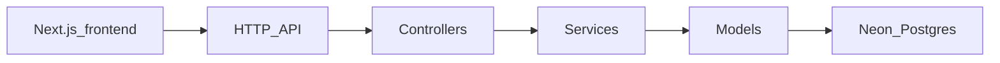

# Shadow Ledger

ספר עצמאי ליועץ פיננסי שעובד בתוך שותפות וצריך להוכיח שהנכסים, עמלות ההיקף והנפרעים תואמים את המערכת של השותף.

[English](README.md) · [איפיון](docs/specification.md) · [מבנה הקוד](Project/README.md)

מערכת השותף נשארת ספר הרישום שלהם. הפרויקט הזה הוא **יומן הצל** של היועץ: כל עסקה נשמרת אצלו, מחושבת לפי גרסת ההסכם שחלה בתאריך שלה, ואז נבדקת מול השותף. שינוי עתידי בתנאי השותפות לא משכתב עמלה שכבר הוכרה.

## הפיילוט

הגרסה הראשונה היא כלי בקרה, לא מערכת CRM.

- שווי תיק פעיל, מחולק לתיק בסיס ולגיוסי שותפות
- עמלת היקף שנכנסה לכיס החודש, אחרי מע״מ, הוצאות מטה וחלוקת השותפות
- תוספת נפרעים שנכנסה עם התיק החודש, והקצב השנתי שנגזר ממנה
- יעד גיוס חודשי ושנתי, אחוז השלמה, מספר עסקאות וממוצע עמלת היקף
- פילוח שווי התיק לפי יצרן, בשקלים ובאחוזים
- לקוח עם כמה מוצרים אצל כמה יצרנים
- עסקה שנרשמת כצפי, נקלטת בסכום הסופי, ומסומנת כתואמת או כפער

פגישות, רדאר החזר העמלות ל-24 חודשים, קליטה בכמה פעימות ו-CRM תפעולי כתובים באיפיון ונשארים לשלב הבא.

## איך עסקה זזה

1. היועץ רושם לקוח, יצרן, מוצר וסכום צפוי. המנוע מציג את העמלה לפי גרסת ההסכם שבתוקף באותו תאריך.
2. כשהיצרן מסיים, היועץ מאשר את הסכום שנקלט בפועל. שווי התיק והעמלה המוכרת מתעדכנים יחד, והמספרים נקפאים על העסקה.
3. היועץ משווה את התוצאה למערכת השותף ומסמן התאמה, או מסמן פער וכותב הערה.
4. גרסת הסכם חדשה חלה רק על עסקאות שנקלטו אחרי שנכנסה לתוקף.

## ארכיטקטורה

הממשק והתחום העסקי מופרדים. אפשר לקרוא ולבדוק את כללי העמלה בלי להציג מסך.



- **פרונט.** Next.js, עברית, ימין לשמאל, ניתן להתקנה כ-PWA, ומפורסם ב-Vercel. המסכים אוספים קלט ומציגים את הספר. הם לא מחזיקים את כללי העמלה.
- **Controllers.** מקבלים את הבקשה, מאמתים אותה, וקוראים את הדייר מהסשן בשרת. הלקוח לא שולח `tenant_id`.
- **Services.** בוחרים את גרסת ההסכם, מפעילים את כללי העמלה, מרכיבים את נתוני הדאשבורד, ומקפיאים את התוצאה על העסקה.
- **Models.** שומרים לקוחות, עסקאות, יצרנים, גרסאות הסכם וכללים.
- **מסד נתונים.** Neon Postgres. בכל טבלת דייר יש `tenant_id`. Row-Level Security נאכף, ושאילתה בלי הקשר דייר לא מחזירה שורות.

בפיילוט יש יועץ אחד. אותה סכמה יכולה לפתוח דייר משלם נוסף בלי שינוי מבני.

## המאגר

```text
README.md                 מבוא באנגלית
README.he.md              מבוא בעברית
docs/specification.md     איפיון המוצר והחישוב
Project/                  קוד האפליקציה
Project/frontend/         הממשק, ייווצר כשייבנה ה-UI
Project/backend/          ה-API, ייווצר כשייבנה השירות
```

האפליקציה עדיין לא הוקמה. `Project/README.md` מתאר את מבנה המודולים שה-API יעקוב אחריו: תיקייה לכל תחום, עם controller, service ו-model בנפרד.

## סטטוס

איפיון ומבנה המאגר. Next.js וה-API הם שלב הבנייה הבא, והם לא חלק מהקומיט הזה.

## הבהרה

Shadow Ledger הוא כלי התאמה פרטי לספר של היועץ. הוא לא נותן ייעוץ השקעות, לא מבצע פעולות, ואינו מערכת ייעוץ מפוקחת.
