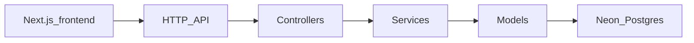

# Shadow Ledger

An independent book for a financial advisor who originates business inside a partnership and needs to prove that assets, scope commissions, and ongoing fees match the partner’s system.

[עברית](README.he.md) · [Specification](docs/specification.md) · [Code layout](Project/README.md)

The partner’s platform remains their book of record. This project is the advisor’s **shadow ledger**: every deal is stored locally, calculated from a dated agreement version, and then checked against the partner. A later change to the partnership terms does not rewrite a fee that was already recognized.

## Pilot

The first version is a control tool, not a CRM.

- Active assets under management, split into a base book and partnership recruitment
- Scope commission that landed in the advisor’s pocket this month, after VAT, headquarters overhead, and the partnership split
- Ongoing commission added with this month’s book, plus the annualized pace
- Monthly and yearly recruitment targets, completion, deal count, and average scope fee
- Book value by manufacturer, in shekels and in percent
- A client with many products across manufacturers
- A deal recorded as an expectation, absorbed at the final amount, then marked matched or discrepant

Meetings, the 24-month clawback radar, split absorption, and operational CRM are specified and deliberately left for a later phase.

## How a deal moves

1. The advisor records the client, manufacturer, product, and expected amount. The engine previews the fee from the agreement version in force on that date.
2. When the manufacturer finishes, the advisor confirms the amount actually absorbed. Assets and the recognized fee update together, and the numbers are frozen on the deal.
3. The advisor compares the result with the partner’s system and marks it matched, or marks a discrepancy and writes a note.
4. A new agreement version applies only to deals absorbed after it takes effect.

## Architecture

The interface and the domain are separate. Commission rules can be read and tested without rendering a screen.



- **Frontend.** Next.js, Hebrew, right-to-left, installable as a PWA, deployed on Vercel. Screens collect input and render the ledger. They do not own the fee rules.
- **Controllers.** Accept the request, validate it, and read the tenant from the server session. The client never sends `tenant_id`.
- **Services.** Select the agreement version, apply the commission rules, build dashboard figures, and snapshot the result onto the deal.
- **Models.** Persist clients, deals, manufacturers, agreement versions, and rules.
- **Database.** Neon Postgres. Every tenant table carries `tenant_id`. Row-level security is forced, so a query without the tenant context returns nothing.

One advisor uses the pilot. The same schema can open a second paying tenant without a structural change.

## Repository

```text
README.md                 English introduction
README.he.md              Hebrew introduction
docs/specification.md     product and calculation spec
Project/                  application code
Project/frontend/         interface, created when the UI is built
Project/backend/          API, created when the service is built
```

The application is not scaffolded yet. `Project/README.md` describes the module layout that the API will follow: one folder per domain, with a controller, a service, and a model kept apart.

## Status

Specification and repository layout. Next.js and the API are the next build, and they are not part of this commit.

## Disclaimer

Shadow Ledger is a private reconciliation tool for the advisor’s own book. It does not provide investment advice, it does not execute trades, and it is not a regulated advisory platform.
